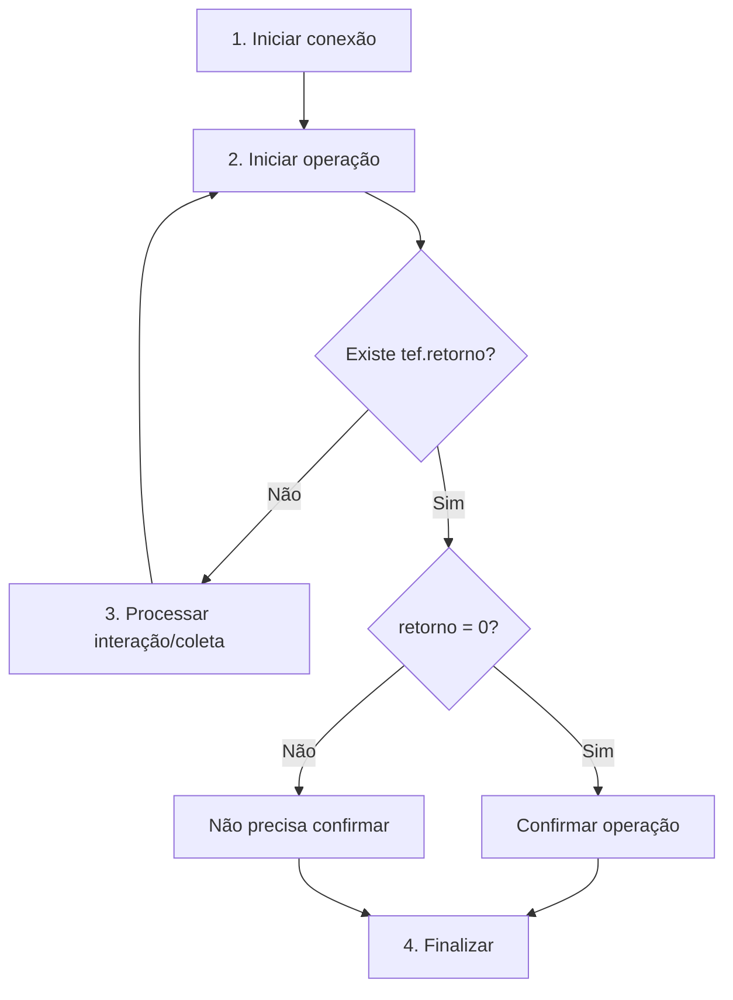
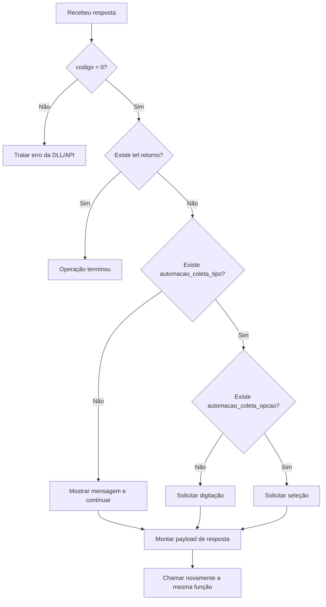

# Elgin TEF — Comece Aqui

> Guia rápido para entender o fluxo da integração antes de entrar nos detalhes das funções e das chaves.

---

## Visão geral

Uma operação TEF pode ser entendida em **4 etapas**:



### Regra principal

> **Enquanto o objeto `tef` NÃO possuir a chave `retorno`, a operação ainda não terminou.**

Nesse caso, processe a resposta do TEF e chame novamente **a mesma função da operação**.

---

# 1. Inicializar a comunicação

Antes de qualquer pagamento, PIX ou operação administrativa, chame:

```cpp
IniciarOperacaoTEF(dadosCaptura)
```

Se o Client e os dados do PDV já estiverem configurados com `SetClientTCP()` e `ConfigurarDadosPDV()`, normalmente pode ser enviado:

```json
{}
```

### Exemplo

**Entrada**

```text
IniciarOperacaoTEF({})
```

**Resposta**

```json
{
  "codigo": 0,
  "mensagem": "Sucesso",
  "tef": {
    "identificadorPontoCaptura": "200001047",
    "loja": "Loja001",
    "nomeAC": "Elgin E1_Tef v05.09.00",
    "nomeEstabelecimento": "Elgin",
    "retorno": "1",
    "sequencial": "29",
    "servico": "iniciar",
    "statusClient": "7",
    "textoPinpad": "Elgin E1_Tef v05.09.00",
    "versaoAC": "v05.09.00"
  }
}
```

### Como interpretar

| Campo | Significado |
|---|---|
| `codigo` | Resultado da chamada da DLL/API |
| `mensagem` | Mensagem referente ao `codigo` |
| `tef` | Dados devolvidos pelo Elgin TEF |
| `tef.retorno` | Resultado do serviço TEF |
| `tef.sequencial` | Sequencial do serviço |

> `codigo` e `tef.retorno` são coisas diferentes.

---

# 2. Iniciar uma operação

Exemplo de venda:

```cpp
RealizarPagamentoTEF(
    codigoOperacao,
    dadosCaptura,
    novaTransacao
)
```

### Exemplo

```text
RealizarPagamentoTEF(
    2,
    {
      "formaPagamento": "A vista",
      "valorTotal": "35,00"
    },
    true
)
```

Onde:

| Argumento | Valor | Significado |
|---|---:|---|
| `codigoOperacao` | `2` | Débito |
| `dadosCaptura` | JSON | Dados iniciais |
| `novaTransacao` | `true` | Primeira chamada da operação |

---

# 3. Interpretar cada resposta

Depois de **toda chamada** de pagamento, PIX ou administrativo, siga esta ordem:



---

# 4. Estrutura padrão da resposta

As funções TEF normalmente retornam:

```json
{
  "codigo": 0,
  "mensagem": "Sucesso",
  "tef": {
    "...": "..."
  }
}
```

## Nível 1 — API/DLL

```json
{
  "codigo": 0,
  "mensagem": "Sucesso"
}
```

Indica se a chamada da DLL foi processada.

## Nível 2 — TEF

```json
{
  "tef": {
    "...": "..."
  }
}
```

Contém o estado e os dados da operação TEF.

---

# 5. Como saber se terminou?

## Ainda está em andamento

Exemplo:

```json
{
  "codigo": 0,
  "mensagem": "Sucesso",
  "tef": {
    "automacao_coleta_retorno": "0",
    "automacao_coleta_sequencial": "3",
    "mensagemResultado": "PROCESSANDO..."
  }
}
```

Não existe `tef.retorno`.

Portanto:

> A operação **ainda está acontecendo**.

---

## Terminou

Exemplo:

```json
{
  "codigo": 0,
  "mensagem": "Sucesso",
  "tef": {
    "mensagemResultado": "Transacao aprovada",
    "retorno": "0",
    "sequencial": "969056"
  }
}
```

Agora existe:

```text
tef.retorno
```

Logo:

> A operação terminou.

---

# 6. O que significa `retorno`?

| `retorno` | Significado | Ação |
|---:|---|---|
| `"0"` | Sucesso com confirmação | Chamar `ConfirmarOperacaoTEF()` |
| `"1"` | Sucesso sem confirmação | Seguir para finalização |
| `"2"` | Sequencial inválido | Tratar erro |
| `"3"` | Cancelada pelo operador | Tratar cancelamento |
| `"4"` | Cancelada pelo cliente | Tratar cancelamento |
| `"5"` | Parâmetros inválidos/insuficientes | Corrigir entrada |
| `"6"` | Problema de conexão com ElginTEF | Tratar conexão |
| `"7"` | Problema entre ElginTEF e Rede | Tratar erro |
| `"8"` | Timeout | Tratar timeout |
| `"9"` | Erro/cancelamento | Tratar erro |

---

# 7. Confirmar

Quando a operação finalizar com:

```json
"retorno": "0"
```

use o `sequencial` retornado:

```text
ConfirmarOperacaoTEF(969056, 1)
```

Onde:

```text
acao = 0 → cancelar
acao = 1 → confirmar
```

---

# 8. Finalizar

Ao concluir o fluxo:

```cpp
FinalizarOperacaoTEF(...)
```

Depois dessa chamada, uma nova transação exige uma nova chamada a:

```cpp
IniciarOperacaoTEF(...)
```

---

# Resumo de implementação

```text
1. IniciarOperacaoTEF()

2. Chamar operação com novaTransacao = true

3. Enquanto NÃO existir tef.retorno:
   - exibir mensagemResultado
   - coletar informação, se necessário
   - devolver automacao_coleta_retorno
   - devolver automacao_coleta_sequencial
   - adicionar automacao_coleta_informacao, quando necessário
   - chamar novamente com novaTransacao = false

4. Quando existir tef.retorno:
   - retorno = 0 → confirmar
   - retorno = 1 → não confirmar
   - demais → tratar erro/cancelamento

5. FinalizarOperacaoTEF()
```

---

## Próximos guias

- [02 — Venda completa](02-venda-completa.md)
- [03 — Como funciona a coleta](03-como-funciona-coleta.md)
- [04 — PIX e Administrativo](04-pix-e-administrativo.md)
- [05 — Referência de funções e chaves](05-referencia-funcoes-chaves.md)
