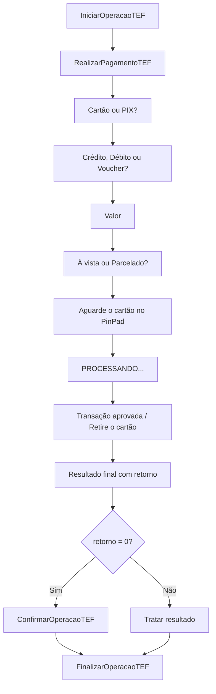

# Venda Completa com Coleta

> **Objetivo:** mostrar uma venda em que a aplicação envia poucos dados inicialmente e deixa o **Elgin TEF conduzir a coleta** das informações necessárias.
>
> O exemplo abaixo foi montado a partir de um fluxo real do log da DLL.

---

## Quando usar este fluxo?

Este modelo é útil quando a aplicação **não quer definir previamente** todos os dados da venda.

Por exemplo, o próprio TEF pode perguntar ao operador:

- Cartão ou PIX?
- Crédito, Débito ou Voucher?
- Qual o valor?
- À vista ou parcelado?

Depois dessas escolhas, o fluxo segue para o PinPad.

---

## Visão geral



---

# 1. Iniciar a comunicação

## Chamada

```text
IniciarOperacaoTEF({})
```

## Exemplo de resposta

```json
{
  "codigo": 0,
  "mensagem": "Sucesso",
  "tef": {
    "identificadorPontoCaptura": "000000",
    "loja": "Loja001",
    "nomeAC": "Elgin E1_Tef v05.06.02",
    "nomeEstabelecimento": "estabelecimento teste",
    "retorno": "1",
    "sequencial": "10",
    "servico": "iniciar",
    "statusClient": "7",
    "textoPinpad": "Elgin Tef Web",
    "versaoAC": "0.0.1"
  }
}
```

### Interpretação

| Verificação | Resultado |
|---|---|
| `codigo == 0` | A chamada da DLL foi processada |
| `tef.retorno == "1"` | A inicialização foi concluída |
| Próximo passo | Iniciar o pagamento |

---

# 2. Iniciar a venda deixando o TEF coletar os dados

No fluxo do log, a chamada foi feita sem definir previamente crédito/débito.

## Chamada

```text
RealizarPagamentoTEF(
    -1,
    {
      "identificadorPontoCaptura": "000000"
    },
    true
)
```

> `true` indica que esta é a **primeira chamada** da operação.

## Resposta

```json
{
  "codigo": 0,
  "mensagem": "Sucesso",
  "tef": {
    "automacao_coleta_opcao": "Cartao;Pix",
    "automacao_coleta_palavra_chave": "transacao",
    "automacao_coleta_retorno": "0",
    "automacao_coleta_sequencial": "0",
    "automacao_coleta_tipo": "X",
    "mensagemResultado": "Selecione a modalidade de pagamento desejada"
  }
}
```

### O que a aplicação deve mostrar?

```text
Selecione a modalidade de pagamento

[ Cartão ]
[ PIX    ]
```

Neste exemplo o operador escolheu:

```text
Cartão
```

---

# 3. Responder "Cartão"

## Payload

```json
{
  "automacao_coleta_informacao": "Cartao",
  "automacao_coleta_retorno": "0",
  "automacao_coleta_sequencial": "0"
}
```

## Chamada

```text
RealizarPagamentoTEF(
    -1,
    payload,
    false
)
```

> A partir daqui `novaTransacao = false`, pois a operação já está em andamento.

## Resposta

```json
{
  "codigo": 0,
  "mensagem": "Sucesso",
  "tef": {
    "automacao_coleta_opcao": "Credito;Debito;Voucher",
    "automacao_coleta_palavra_chave": "transacao_tipo_cartao",
    "automacao_coleta_retorno": "0",
    "automacao_coleta_sequencial": "1",
    "automacao_coleta_tipo": "X",
    "mensagemResultado": "Tipo do Cartao"
  }
}
```

### O que a aplicação deve mostrar?

```text
Tipo do Cartão

[ Crédito ]
[ Débito  ]
[ Voucher ]
```

Neste exemplo o operador escolheu:

```text
Crédito
```

---

# 4. Responder "Crédito"

## Payload

```json
{
  "automacao_coleta_informacao": "Credito",
  "automacao_coleta_retorno": "0",
  "automacao_coleta_sequencial": "1"
}
```

## Resposta

```json
{
  "codigo": 0,
  "mensagem": "Sucesso",
  "tef": {
    "automacao_coleta_palavra_chave": "transacao_valor",
    "automacao_coleta_retorno": "0",
    "automacao_coleta_sequencial": "2",
    "automacao_coleta_tipo": "N",
    "mensagemResultado": "Valor"
  }
}
```

### Interpretação

Temos:

```text
automacao_coleta_tipo = N
```

e não existe `automacao_coleta_opcao`.

Logo, o operador deve **digitar um valor**.

```text
Valor

[ R$ __________ ]
```

No fluxo real:

```text
10.00
```

---

# 5. Enviar o valor

## Payload

```json
{
  "automacao_coleta_informacao": "10.00",
  "automacao_coleta_retorno": "0",
  "automacao_coleta_sequencial": "2"
}
```

## Resposta

```json
{
  "codigo": 0,
  "mensagem": "Sucesso",
  "tef": {
    "automacao_coleta_opcao": "A vista;Parcelado",
    "automacao_coleta_palavra_chave": "transacao_pagamento",
    "automacao_coleta_retorno": "0",
    "automacao_coleta_sequencial": "3",
    "automacao_coleta_tipo": "X",
    "mensagemResultado": "Forma de Pagamento"
  }
}
```

### Interface sugerida

```text
Forma de Pagamento

[ À vista   ]
[ Parcelado ]
```

Neste exemplo:

```text
A vista
```

---

# 6. Responder "À vista"

## Payload

```json
{
  "automacao_coleta_informacao": "A vista",
  "automacao_coleta_retorno": "0",
  "automacao_coleta_sequencial": "3"
}
```

## Resposta

```json
{
  "codigo": 0,
  "mensagem": "Sucesso",
  "tef": {
    "automacao_coleta_palavra_chave": "transacao_cartao_numero",
    "automacao_coleta_retorno": "0",
    "automacao_coleta_sequencial": "4",
    "mensagemResultado": "Aguarde o cartao no PIN-Pad."
  }
}
```

### Interpretação

Não existe `automacao_coleta_tipo`.

Portanto a aplicação não precisa abrir campo nem seleção.

Apenas exiba:

```text
Aguarde o cartão no PinPad.
```

e continue.

---

# 7. Continuar enquanto o PinPad processa

## Payload

```json
{
  "automacao_coleta_retorno": "0",
  "automacao_coleta_sequencial": "4"
}
```

## Resposta

```json
{
  "codigo": 0,
  "mensagem": "Sucesso",
  "tef": {
    "automacao_coleta_retorno": "0",
    "automacao_coleta_sequencial": "5",
    "mensagemResultado": "PROCESSANDO..."
  }
}
```

Mostre:

```text
PROCESSANDO...
```

e continue.

---

# 8. Transação aprovada — ainda não terminou

## Payload

```json
{
  "automacao_coleta_retorno": "0",
  "automacao_coleta_sequencial": "5"
}
```

## Resposta

```json
{
  "codigo": 0,
  "mensagem": "Sucesso",
  "tef": {
    "automacao_coleta_retorno": "0",
    "automacao_coleta_sequencial": "6",
    "mensagemResultado": "Transacao aprovada, RETIRE O CARTAO"
  }
}
```

> **Importante**
>
> Mesmo aparecendo `"Transacao aprovada"`, o fluxo ainda **não terminou**, porque `tef.retorno` ainda não está presente.

Continue chamando a mesma função.

---

# 9. Buscar o resultado final

## Payload

```json
{
  "automacao_coleta_retorno": "0",
  "automacao_coleta_sequencial": "6"
}
```

## Resposta final da venda

```json
{
  "codigo": 0,
  "mensagem": "Sucesso",
  "tef": {
    "cnpjCredenciadora": "30155515000121",
    "codigoAutorizacao": "202052",
    "dataHoraTransacao": "12/06/2026 14:58:45",
    "formaPagamento": "A vista",
    "identificadorEstabelecimento": "52.556.578/0001-22",
    "identificadorPontoCaptura": "200000996",
    "mensagemResultado": "Transacao aprovada",
    "nomeBandeira": "Visa",
    "nomeEstabelecimento": "Elgin",
    "nomeProvedor": "Simulator",
    "nsuTerminal": "000023102",
    "panMascarado": "466201******7734",
    "resultadoTransacao": "0",
    "retorno": "0",
    "sequencial": "287128",
    "servico": "executar",
    "tipoCartao": "Credito",
    "transacao": "Cartao Vender",
    "uniqueID": "50f02175-3628-4854-93ad-0ccf0346eda1",
    "valorTotal": "1000",
    "comprovanteDiferenciadoLoja": "...",
    "comprovanteDiferenciadoPortador": "..."
  }
}
```

Agora temos:

```json
"retorno": "0"
```

Isso significa:

> A transação terminou com sucesso e deve ser confirmada.

---

# 10. Confirmar

Utilize o `sequencial` retornado:

```text
287128
```

## Chamada

```text
ConfirmarOperacaoTEF(287128, 1)
```

Onde:

```text
1 = confirmar
```

## Resposta

```json
{
  "codigo": 0,
  "mensagem": "Sucesso",
  "tef": {
    "mensagemResultado": "Transacao confirmada",
    "retorno": "1",
    "sequencial": "287128",
    "servico": "executar",
    "transacao": "Cartao Vender"
  }
}
```

---

# 11. Finalizar

```text
FinalizarOperacaoTEF(...)
```

Exemplo de resposta:

```json
{
  "codigo": 0,
  "mensagem": "Sucesso",
  "tef": {
    "retorno": "1",
    "sequencial": "12",
    "servico": "finalizar"
  }
}
```

---

# Fluxo completo resumido

```text
IniciarOperacaoTEF
        ↓
RealizarPagamentoTEF(..., true)
        ↓
Cartão ou PIX?
        ↓ Cartão
Crédito / Débito / Voucher?
        ↓ Crédito
Valor?
        ↓ 10.00
À vista / Parcelado?
        ↓ À vista
Aguarde cartão no PinPad
        ↓
PROCESSANDO...
        ↓
Transação aprovada / Retire o cartão
        ↓
Resultado final:
retorno = 0
sequencial = 287128
        ↓
ConfirmarOperacaoTEF(287128, 1)
        ↓
FinalizarOperacaoTEF
```

---

# O que este exemplo ensina?

Este fluxo mostra, em uma única venda, três tipos de interação:

| Tipo | Exemplo |
|---|---|
| Seleção | Crédito / Débito / Voucher |
| Digitação | Valor |
| Mensagem sem entrada | PROCESSANDO... |

Ele também mostra a regra central:

> **A operação só terminou quando `tef.retorno` aparecer.**

---

## Veja também

- [Venda completa com payload](02b-venda-completa-com-payload.md)
- [Como funciona a coleta](03-como-funciona-coleta.md)
- [Referência de funções e chaves](05-referencia-funcoes-chaves.md)
