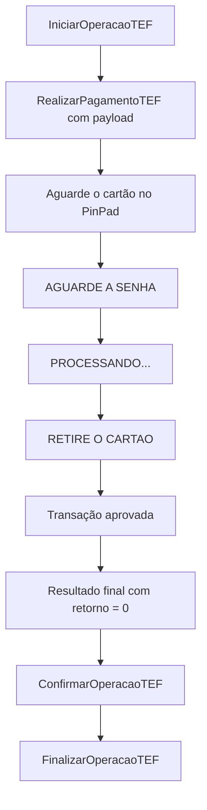

# Venda Completa com Payload

> **Objetivo:** mostrar uma venda em que a aplicação **já possui os principais dados** e os envia na primeira chamada, reduzindo a quantidade de perguntas feitas pelo TEF.
>
> O exemplo abaixo usa um fluxo real de venda no débito.

---

## Quando usar este fluxo?

Use este modelo quando o seu PDV já sabe, por exemplo:

- o tipo de cartão;
- o valor;
- a forma de pagamento.

Nesse cenário, a aplicação não precisa deixar o TEF perguntar:

```text
Crédito ou Débito?
Qual o valor?
À vista ou Parcelado?
```

Esses dados já são enviados no início.

---

## Comparação rápida

| Com coleta | Com payload |
|---|---|
| TEF pergunta Crédito/Débito | PDV já informa Débito |
| TEF pode perguntar valor | PDV já envia valor |
| TEF pode perguntar forma | PDV já envia À vista |
| Mais interações | Fluxo mais direto |

---

## Visão geral



---

# 1. Iniciar a comunicação

## Chamada

```text
IniciarOperacaoTEF({})
```

## Exemplo de resposta

```json
{
  "codigo": 0,
  "mensagem": "Sucesso",
  "tef": {
    "identificadorPontoCaptura": "200001047",
    "loja": "Loja001",
    "nomeAC": "Elgin E1_Tef v05.09.00",
    "nomeEstabelecimento": "Elgin",
    "retorno": "1",
    "sequencial": "29",
    "servico": "iniciar",
    "statusClient": "7",
    "textoPinpad": "Elgin E1_Tef v05.09.00",
    "versaoAC": "v05.09.00"
  }
}
```

---

# 2. Iniciar a venda já informando os dados

Neste exemplo o PDV já sabe:

```text
Tipo       → Débito
Forma      → À vista
Valor      → R$ 35,00
```

Para débito:

```text
codigoOperacao = 2
```

## Chamada

```text
RealizarPagamentoTEF(
    2,
    {
      "formaPagamento": "A vista",
      "valorTotal": "35,00"
    },
    true
)
```

### O que cada argumento representa?

| Argumento | Valor | Significado |
|---|---|---|
| `codigoOperacao` | `2` | Débito |
| `dadosCaptura` | JSON | Dados já conhecidos pelo PDV |
| `novaTransacao` | `true` | Início de uma nova venda |

> Como o tipo de cartão já foi informado em `codigoOperacao`, o TEF não precisa perguntar Crédito/Débito.

---

# 3. Aguardar o cartão

## Resposta

```json
{
  "codigo": 0,
  "mensagem": "Sucesso",
  "tef": {
    "automacao_coleta_palavra_chave": "transacao_cartao_numero",
    "automacao_coleta_retorno": "0",
    "automacao_coleta_sequencial": "1",
    "mensagemResultado": "Aguarde o cartao no PIN-Pad."
  }
}
```

### Interpretação

Não existe:

```text
tef.retorno
```

Logo a venda ainda está em andamento.

Também não existe `automacao_coleta_tipo`, então não há nada para o operador digitar no PDV.

A aplicação apenas exibe:

```text
Aguarde o cartão no PinPad.
```

---

# 4. Continuar

## Payload

```json
{
  "automacao_coleta_retorno": "0",
  "automacao_coleta_sequencial": "1"
}
```

## Chamada

```text
RealizarPagamentoTEF(
    2,
    payload,
    false
)
```

## Resposta

```json
{
  "codigo": 0,
  "mensagem": "Sucesso",
  "tef": {
    "automacao_coleta_retorno": "0",
    "automacao_coleta_sequencial": "2",
    "mensagemResultado": "AGUARDE A SENHA"
  }
}
```

A senha é digitada no PinPad, não no PDV.

---

# 5. Processamento

## Payload

```json
{
  "automacao_coleta_retorno": "0",
  "automacao_coleta_sequencial": "2"
}
```

## Resposta

```json
{
  "codigo": 0,
  "mensagem": "Sucesso",
  "tef": {
    "automacao_coleta_retorno": "0",
    "automacao_coleta_sequencial": "3",
    "mensagemResultado": "PROCESSANDO..."
  }
}
```

Mostrar:

```text
PROCESSANDO...
```

---

# 6. Retirar o cartão

## Payload

```json
{
  "automacao_coleta_retorno": "0",
  "automacao_coleta_sequencial": "3"
}
```

## Resposta

```json
{
  "codigo": 0,
  "mensagem": "Sucesso",
  "tef": {
    "automacao_coleta_retorno": "0",
    "automacao_coleta_sequencial": "4",
    "mensagemResultado": "RETIRE O CARTAO"
  }
}
```

---

# 7. Mensagem de aprovação

## Payload

```json
{
  "automacao_coleta_retorno": "0",
  "automacao_coleta_sequencial": "4"
}
```

## Resposta

```json
{
  "codigo": 0,
  "mensagem": "Sucesso",
  "tef": {
    "automacao_coleta_retorno": "0",
    "automacao_coleta_sequencial": "5",
    "mensagemResultado": "Transacao aprovada, RETIRE O CARTAO"
  }
}
```

> A mensagem diz que foi aprovada, mas ainda não existe `tef.retorno`.
>
> Portanto a aplicação deve continuar.

---

# 8. Resultado final da venda

## Payload

```json
{
  "automacao_coleta_retorno": "0",
  "automacao_coleta_sequencial": "5"
}
```

## Resposta final

```json
{
  "codigo": 0,
  "mensagem": "Sucesso",
  "tef": {
    "cnpjCredenciadora": "30155515000121",
    "codigoAutorizacao": "194567",
    "comprovanteDiferenciadoLoja": "...",
    "comprovanteDiferenciadoPortador": "...",
    "dataHoraTransacao": "13/07/2026 16:58:59",
    "formaPagamento": "A vista",
    "identificadorEstabelecimento": "52.556.578/0001-22",
    "identificadorPontoCaptura": "200001047",
    "mensagemResultado": "Transacao aprovada",
    "nomeBandeira": "MasterCard",
    "nomeEstabelecimento": "Elgin",
    "nomeProvedor": "Simulator",
    "nsuTerminal": "000024565",
    "panMascarado": "550209******8198",
    "resultadoTransacao": "0",
    "retorno": "0",
    "sequencial": "969056",
    "servico": "executar",
    "tipoCartao": "Debito",
    "transacao": "Cartao Vender",
    "uniqueID": "b530d582-69b9-4151-9dce-517bf32139b8",
    "valorTotal": "3500"
  }
}
```

Agora temos:

```json
"retorno": "0"
```

Então:

> A venda terminou com sucesso e precisa ser confirmada.

---

# 9. Confirmar

O resultado final retornou:

```json
"sequencial": "969056"
```

## Chamada

```text
ConfirmarOperacaoTEF(969056, 1)
```

## Resposta

```json
{
  "codigo": 0,
  "mensagem": "Sucesso",
  "tef": {
    "mensagemResultado": "Transacao confirmada",
    "retorno": "1",
    "sequencial": "969056",
    "servico": "executar",
    "transacao": "Cartao Vender"
  }
}
```

---

# 10. Finalizar

```text
FinalizarOperacaoTEF(...)
```

Exemplo:

```json
{
  "codigo": 0,
  "mensagem": "Sucesso",
  "tef": {
    "retorno": "1",
    "sequencial": "31",
    "servico": "finalizar"
  }
}
```

---

# Fluxo completo resumido

```text
PDV já sabe:
Débito + À vista + R$ 35,00
        ↓
RealizarPagamentoTEF(
    2,
    {
      "formaPagamento": "A vista",
      "valorTotal": "35,00"
    },
    true
)
        ↓
Aguarde cartão no PinPad
        ↓
AGUARDE A SENHA
        ↓
PROCESSANDO...
        ↓
RETIRE O CARTÃO
        ↓
Transação aprovada
        ↓
Resultado final:
retorno = 0
sequencial = 969056
        ↓
ConfirmarOperacaoTEF(969056, 1)
        ↓
FinalizarOperacaoTEF
```

---

# Por que este fluxo tem menos perguntas?

Porque a aplicação já forneceu:

```text
codigoOperacao = 2
    ↓
Débito

formaPagamento = "A vista"
    ↓
À vista

valorTotal = "35,00"
    ↓
Valor da venda
```

O TEF pode então avançar diretamente para as etapas que dependem do cartão e do PinPad.

---

# Quando escolher cada modelo?

## Venda com coleta

Use quando você quer que o TEF conduza as escolhas:

```text
Cartão ou PIX?
Crédito ou Débito?
Valor?
À vista ou Parcelado?
```

➡️ Veja [Venda completa com coleta](02a-venda-completa-com-coleta.md)

## Venda com payload

Use quando seu PDV já possui esses dados e quer reduzir interações.

```text
PDV define os dados
        ↓
TEF segue para o PinPad
```

---

## Veja também

- [Venda completa com coleta](02a-venda-completa-com-coleta.md)
- [Como funciona a coleta](03-como-funciona-coleta.md)
- [Referência de funções e chaves](05-referencia-funcoes-chaves.md)
